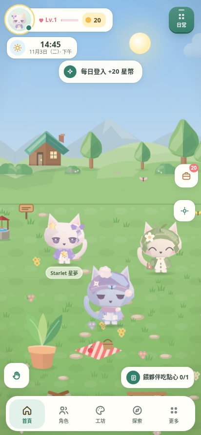

# OC Shimeji Android 3.2.2

把 `oc-shimeji-3_2_1-stable.html` 包裝成可離線執行的 Android App，保留原有繁體中文介面、角色、小島、養成、商店、繪畫工坊與動畫工作室。Android 層使用 Java + WebView，無需架設網站或後端。



## 3.2.2 效能與體驗更新

這一版直接修正場景引擎的重複更新、排序互相覆寫和強制重排，並減少 Android WebView 的合成圖層負擔：

- 靜態花海／草地合成單一已解碼圖片；保留互動物件、碰撞、原始角色素材與存檔格式。
- 環境與角色共用更新迴圈，隱藏頁面、開啟面板與切到背景時暫停不必要工作。
- 角色跳躍不再帶著整座島上下晃動；鏡頭跟隨有緩衝區。
- 修正角色與家具排序反覆覆寫，以及縮放後週期性重建圖層的閃爍來源。
- 對話改用場景座標定位，不再逐幀量測角色；移除看不見的逐字動畫。
- 底部導覽預設有文字、HUD 尺寸固定，返回鍵可關閉快捷面板和拍照模式。
- 設定新增「流暢／省電／完整動態」；預設流暢，省電模式以 30 FPS 為更新上限。
- Android 拍照模式可直接擷取 App 畫面並另存 PNG。
- 完整備份還原補上新版個性、技能、圖鑑、島上擺設、畫面偏好與導覽設定，並轉換角色 ID；完成後會重新載入小島。

測試結果和量測限制見 [docs/VALIDATION.md](docs/VALIDATION.md)，變更說明見 [docs/CHANGELOG-3.2.2.md](docs/CHANGELOG-3.2.2.md)。

## 快速開始：在 GitHub 取得 APK

1. 解壓縮專案，在 GitHub 建立一個空白 repository。
2. 將專案根目錄的**所有檔案與資料夾**上傳至 repository。根目錄必須直接看得到 `settings.gradle.kts`、`gradlew` 和 `app/`，並且要包含隱藏的 `.github/workflows/android.yml` 與 `gradle/wrapper/gradle-wrapper.jar`。不要只上傳 ZIP，也不要多包一層資料夾。
3. 推送到 `main` 或 `master` 後，開啟 GitHub 的 **Actions → Build Android APK**。也可點 **Run workflow** 手動建置。
4. 等待綠色勾勾，打開該次執行，在 **Artifacts** 下載 `OC-Shimeji-3.2.2-debug`，解壓縮後取得 `app-debug.apk`。
5. 將 APK 傳到 Android 手機開啟，依系統提示允許該來源安裝，再安裝 App。

GitHub Actions 會執行 `assembleDebug lintDebug`，以及獨立的瀏覽器流程回歸檢查，不需要 GitHub Secrets 或自行準備簽署金鑰。若 repository 的 Actions 被停用，先在該 repository 的 Actions 頁面啟用。

也可用 Git 上傳：

```sh
git init -b main
git add .
git update-index --chmod=+x gradlew
git commit -m "Add OC Shimeji Android project"
git remote add origin https://github.com/YOUR_NAME/YOUR_REPO.git
git push -u origin main
```

請將 `YOUR_NAME/YOUR_REPO` 換成自己的 repository。Windows 也可使用 GitHub Desktop 發佈整個專案資料夾。

## 本機建置

- Android 8.0 / API 26 以上。
- 請保持 Android System WebView / Chrome 更新；原畫面使用現代 CSS 與 JavaScript。
- Android Studio Meerkat 2024.3.1 或更新版本，Gradle JDK 選 **17**。
- Android SDK Platform 35、Build Tools 35.0.0。
- 本專案固定使用 Android Gradle Plugin 8.9.2、Gradle 8.11.1，Wrapper 已包含。

使用 Android Studio 開啟此根目錄，等待 Gradle Sync，再按 Run；或設定 `ANDROID_HOME` 指向 Android SDK 後執行：

```sh
# macOS / Linux
chmod +x gradlew
./gradlew assembleDebug lintDebug

# Windows
.\gradlew.bat assembleDebug lintDebug
```

輸出 APK：`app/build/outputs/apk/debug/app-debug.apk`。

## 已接好的 Android 功能

| 功能 | 行為 |
| --- | --- |
| 離線執行 | HTML、CSS、JS 與內建角色都包含在 APK，核心功能不需連網 |
| 本機存檔 | 啟用 localStorage 與 IndexedDB；關閉再開啟仍保留進度 |
| 圖片與 JSON 匯入 | 系統文件選擇器，支援多張角色圖片；無需全裝置儲存權限 |
| 角色／動畫／完整備份匯出 | 開啟系統「另存新檔」，選擇資料夾與檔名後儲存 |
| 工坊舊版下載入口 | 接管 Blob / data URL 下載，改用系統另存 |
| 拍照模式 | 隱藏介面後擷取 App 畫面，透過系統另存為 PNG |
| 檔案分享 | 透過 Android 分享面板與 FileProvider 授權單一檔案 |
| 返回鍵／手勢 | 優先關閉彈窗與編輯畫面、再回首頁，首頁兩次返回離開 |
| 深淺主題與螢幕邊界 | 系統列隨主題更新，避開狀態列、導覽列、瀏海與鍵盤 |
| 觸覺回饋 | 接到 Android 震動，遵循原本的觸覺回饋開關 |
| 即時天氣 | 僅在原介面啟用定位天氣時請求概略位置，再查詢 Open-Meteo |

**懸浮於其他 App 上方的桌寵、通知提醒、桌面 Widget 尚未實作。** 原 HTML 將這些列為規劃功能；此版本明確標示，並停用懸浮窗開關。

## 資料與安裝注意事項

- 預設套件名稱是 `com.ocshimeji.app`。更新 App 時請保持相同套件名稱與簽署金鑰。
- 所有角色與養成資料都存在 App 內；**解除安裝或清除 App 資料會刪除存檔**。請先在設定匯出完整備份。
- 瀏覽器版與 Android 版使用不同儲存區。將瀏覽器中的既有進度匯出完整備份，再於 Android 版匯入。
- 單次原生匯出／分享上限 **32 MB**，較大的角色庫請分批匯出。
- 分享 Promise 在系統分享面板成功開啟時完成；最終是否傳送由使用者與接收 App 決定。
- 位置權限可以拒絕；天氣功能會使用原程式的預設處理，其餘離線功能可繼續使用。
- 未加入廣告、登入、分析或自架伺服器。原生網路攔截只允許本機 App 資源與 `https://api.open-meteo.com`。

## 正式版簽署

Actions 產物是供安裝測試的 **debug APK**。GitHub 的不同執行環境可能產生不同的 debug 金鑰，因此不同次下載的 APK 不保證可以直接覆蓋安裝；若遇到簽章不同，先備份資料。

正式發佈請在 Android Studio 選 **Build → Generate Signed App Bundle / APK**，建立並妥善保管自己的 release keystore。使用相同金鑰簽署後續版本，並遞增 `app/build.gradle.kts` 中的 `versionCode`。此專案不內含私人金鑰，`assembleRelease` 預設產生未簽署 APK；不要直接作為正式安裝檔發佈。Play 商店上架時請確認當時的 target SDK 要求。

## 修改與維護

```text
.github/workflows/android.yml       GitHub 自動建置與 APK 下載
app/src/main/assets/index.html      應用程式與已修正的場景引擎
app/src/main/assets/runtime-core.js 繪製偏好與不觸發版面的地形判定
app/src/main/assets/app-polish.js   場景合併、對話、HUD、暫停與畫面選項
app/src/main/assets/app-polish.css  統一視覺、觸控目標與動效規則
app/src/main/assets/android-adapter.js
                                   匯出、分享、存檔與 Android UI 接口
app/src/main/java/com/ocshimeji/app/MainActivity.java
                                   WebView、文件選擇器、權限與原生橋接
app/src/main/AndroidManifest.xml    App 名稱、權限、Activity 與 FileProvider
app/src/main/res/drawable/ic_launcher.xml
                                   內建貓咪 App 圖示
app/build.gradle.kts               套件名稱、SDK 與版本
```

替換 HTML 時，需保留 `runtime-core.js`、`app-polish.js`、`app-polish.css` 和 `android-adapter.js` 的引用；直接覆蓋成原始 3.2.1 HTML 會失去這次在引擎內修正的效能與備份問題。Adapter 使用原檔的 `OCApp`、`Settings`、`Chars` 等接口，升級 HTML 後需重新驗證匯入／匯出與返回操作。

修改套件名稱時，同步更新 Gradle 的 `namespace` / `applicationId`、Java 的 package 與目錄、`proguard-rules.pro`；若只想建立獨立安裝的分支，僅修改 `applicationId` 即可。

來源說明見 [docs/SOURCE.md](docs/SOURCE.md)，驗證紀錄見 [docs/VALIDATION.md](docs/VALIDATION.md)。原 HTML 與素材的權利歸原權利人所有；本次未替其新增開源授權。


## 回歸檢查

```sh
python -m pip install -r tests/requirements.txt
python -m playwright install chromium
python tests/web_regression.py
```

若已有系統 Chromium，可用 `python tests/web_regression.py --chromium /usr/bin/chromium`。測試使用隔離的瀏覽器存檔與 mock Android 橋接，會驗證 UI 與資料流程；系統檔案選擇器、分享面板、PixelCopy、權限與真機效能仍需在 Android 上驗證。

效能量測工具：`python tests/performance_audit.py --throttle 4 --seconds 10`（使用系統 Chromium 時加上 `--chromium /usr/bin/chromium`）。這是瀏覽器模擬，不代表各手機機型的實際 FPS。
